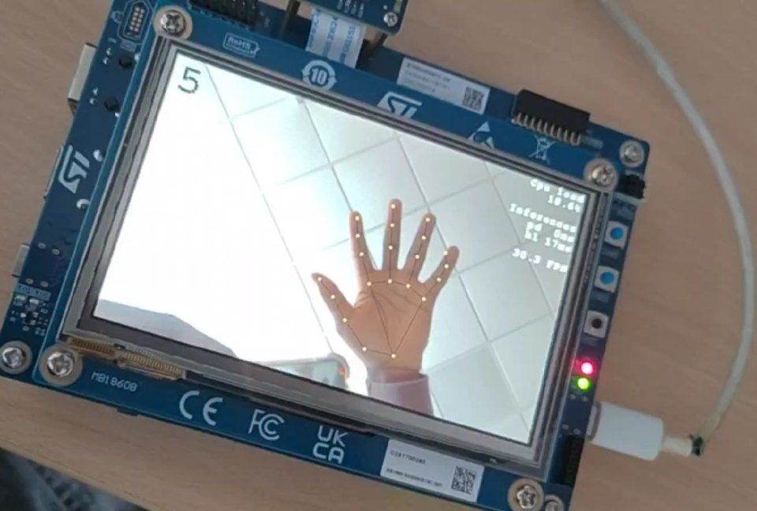
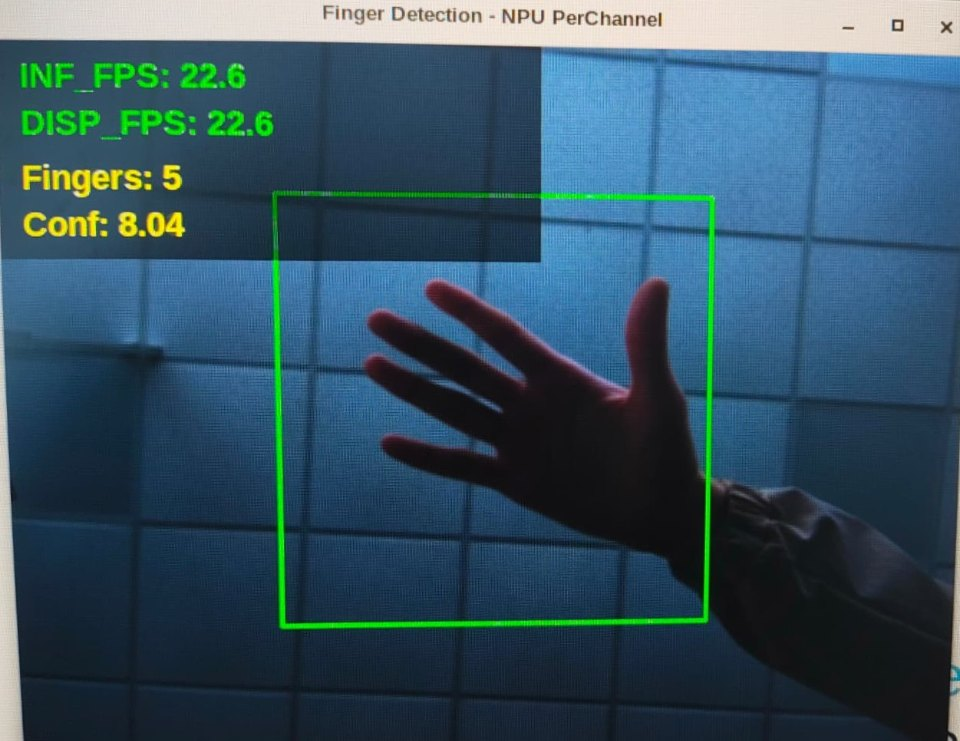

# IA embarquée sur STM32 : STM32N6570-DK et STM32MP257F-DK

Projet de Master 2 Objets connectés (Université de Poitiers, 2025-2026), réalisé en équipe de quatre et encadré par Hervé Boeglen.

L'objectif était de comparer l'exécution de modèles de vision sur deux cartes STMicroelectronics équipées d'un NPU : un microcontrôleur et un microprocesseur.

| Carte | Type | Cœur principal | NPU | Environnement |
|---|---|---|---|---|
| STM32N6570-DK | Microcontrôleur | Cortex-M55, 800 MHz | Neural-ART, 600 GOPS | Bare-metal / RTOS |
| STM32MP257F-DK | Microprocesseur | 2 × Cortex-A35, 1,5 GHz | NPU intégré, 1,35 TOPS | OpenSTLinux |

## Chaîne de déploiement

1. Modèle entraîné ou récupéré sous Python, puis exporté en ONNX ou TFLite.
2. Quantification INT8 sur ST Edge AI Developer Cloud, à partir d'un jeu de calibration.
3. STM32N6570-DK : code C généré avec X-CUBE-AI, intégré dans un projet STM32CubeIDE, puis carte programmée avec STM32CubeProgrammer.
4. STM32MP257F-DK : modèle ONNX exécuté avec ONNX Runtime sous Linux, avec délégation au NPU (`VSINPUExecutionProvider`).

## Résultats (rapport final, mars 2026)

| Carte | Application | Inférence | Débit mesuré |
|---|---|---|---|
| STM32MP257F-DK | Détection de visages (BlazeFace) | 25 ms (estimation ST Edge AI) | 18 images/s |
| STM32MP257F-DK | Reconnaissance de gestes (MobileNetV2, 6 classes) | 33 ms (estimation ST Edge AI) | 22 images/s |
| STM32N6570-DK | Détection et reconnaissance de visages (CenterFace + MobileFaceNet) | 129 ms (estimation ST Edge AI) | 6 images/s |
| STM32N6570-DK | Reconnaissance de gestes (paume, 21 points clés, règle géométrique) | 15 ms | 30 images/s |

Conclusion du rapport : pour ces tâches, le microcontrôleur est le plus adapté. Il atteint la précision demandée par le cahier des charges sans la complexité d'un système d'exploitation complet.

## Démonstrations

<table>
  <tr>
    <td align="center"></td>
    <td align="center"></td>
  </tr>
  <tr>
    <td align="center"><b>STM32N6570-DK</b> : paume et 21 points clés sur le NPU, comptage géométrique des doigts, 30 images/s</td>
    <td align="center"><b>STM32MP257F-DK</b> : MobileNetV2 quantifié en INT8 sur le NPU, 22 images/s</td>
  </tr>
</table>

## Contenu du dépôt

| Dossier | Partie |
|---|---|
| [`STM32MP257F-DK/face-detection`](STM32MP257F-DK/face-detection) | Détection de visages BlazeFace sous Linux |
| [`STM32MP257F-DK/gesture-recognition`](STM32MP257F-DK/gesture-recognition) | Reconnaissance de gestes MobileNetV2 sous Linux, avec la collecte des données et l'entraînement sur PC |

Les applications STM32N6570-DK seront ajoutées.

## Équipe

| Membre | Rôle |
|---|---|
| Koundeme Djessou | Product Owner, partie embarquée |
| Hafsa El Majdoub | Scrum Master |
| Ismail Abdelaali | Modèles de machine learning |
| Rayane Djenadou | Intégration sur les cartes et mesures de performance |

Le code des parties STM32MP257F-DK provient des dépôts de l'équipe : [rayane2222/Face-Recognition](https://github.com/rayane2222/Face-Recognition) et [rayane2222/Gesture-Recognition](https://github.com/rayane2222/Gesture-Recognition).

## Crédits

- BlazeFace : Google Research, MediaPipe (licence Apache 2.0).
- Portage PyTorch de BlazeFace : Matthijs Hollemans (voir [`LICENSE`](STM32MP257F-DK/face-detection/BlazeFace-PyTorch/LICENSE)).
- MobileNetV2 : torchvision, poids pré-entraînés sur ImageNet.
- Les photos de test et de calibration, ainsi que le jeu de données de gestes, ne sont pas publiés ici : utilisez vos propres images.
