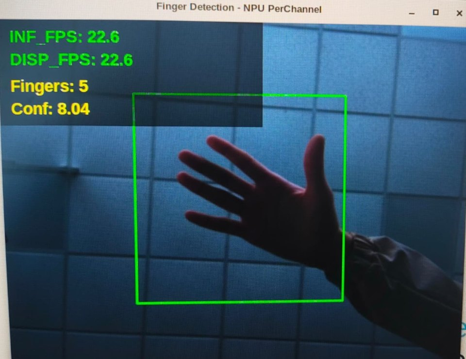

# Reconnaissance de gestes sur STM32MP257F-DK

Partie « reconnaissance de gestes » du projet, côté microprocesseur (OpenSTLinux). Le modèle compte les doigts levés à partir de l'image de la caméra : six classes, de 0 à 5.



## Application sur la carte : `finger_detection.py`

- Capture caméra avec GStreamer (`libcamerasrc`, 640 × 480).
- Recadrage du carré central (60 % de l'image), redimensionnement en 128 × 128 et normalisation entre 0 et 1.
- Inférence du modèle quantifié `gesture_model_PerChannel_quant.onnx` (INT8, quantification par canal) avec ONNX Runtime, sur le NPU (`VSINPUExecutionProvider`), avec repli sur le CPU.
- Affichage GTK : zone où placer la main, nombre de doigts, score, images par seconde (inférence et affichage).

Prérequis sur la carte : Python 3, ONNX Runtime avec le fournisseur VSINPU, OpenCV, GStreamer avec `libcamerasrc`, PyGObject (GTK 3) et pycairo.

```bash
python3 finger_detection.py
```

Résultats mesurés pendant le projet : 22 images par seconde sur la carte, pour un temps d'inférence estimé à 33 ms par ST Edge AI Developer Cloud. La reconnaissance reste moyenne : le jeu de données, pris dans un seul environnement, rend le modèle sensible aux changements d'éclairage et d'arrière-plan.

## Entraînement sur PC : `training/`

Modèle MobileNetV2 de torchvision, pré-entraîné sur ImageNet, dont la dernière couche est remplacée pour les six classes.

| Script | Rôle |
|---|---|
| `collect_dataset.py` | Collecte d'images à la webcam, rangées par classe dans `dataset/0` à `dataset/5` (carré central, 128 × 128) |
| `train.py` | Entraînement (8 époques, Adam, taux d'apprentissage 1e-4, retournement et rotation aléatoires), courbes de précision et matrice de confusion |
| `export_onnx.py` | Export du modèle `.pth` vers ONNX |
| `test_model_pc.py` | Test en temps réel à la webcam avec PyTorch |
| `test_onnx_pc.py` | Test en temps réel à la webcam avec ONNX Runtime |
| `make_calib.py` | Jeu de calibration `calibration.npz` (50 images par classe) pour la quantification INT8 |

### Installation

```bash
pip install torch torchvision opencv-python numpy onnx onnxruntime tqdm matplotlib scikit-learn
```

### Utilisation

```bash
cd STM32MP257F-DK/gesture-recognition/training
python collect_dataset.py   # touches 0 à 5 : classe, S : sauvegarde, A : capture auto, + / - : cadence, Q : quitter
python train.py             # -> models/gesture_model.pth, courbes et matrice de confusion
python export_onnx.py       # -> models/gesture_model.onnx
python test_onnx_pc.py      # test à la webcam
python make_calib.py        # -> calibration.npz
```

Le jeu de données collecté pendant le projet (environ 6 000 images, 1 000 par classe) n'est pas publié : collectez le vôtre avec `collect_dataset.py`.
